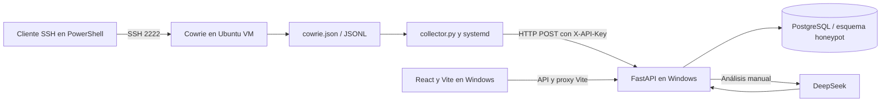

# TacticLens

TacticLens es un prototipo académico para observar intentos de acceso SSH en un entorno controlado. Cowrie simula un servidor SSH y registra conexiones, autenticaciones y comandos; un recolector envía esos eventos a FastAPI, que los conserva en PostgreSQL. La interfaz React permite revisar sesiones históricas, ejecutar un análisis con DeepSeek y consultar indicadores de compromiso (IoCs) y asociaciones propuestas con MITRE ATT&CK. Un IoC es un valor observable, como una IP, dominio, URL o hash; un mapeo MITRE describe la técnica que podría explicar una acción. Ambos se muestran junto a su evidencia para revisión humana.

**Implementado:** ingesta automática o importación manual, deduplicación de eventos, consulta y paginación, análisis manual de cualquier sesión con eventos, reutilización de resultados vigentes, reintento de fallos, bloqueo de análisis simultáneos por sesión, aviso cuando llegan eventos nuevos, IoCs y mapeos con evidencia. También incluye registro con autorización administrativa, verificación de correo, Google Authenticator obligatorio, recuperación, sesiones revocables, roles y auditoría. **Pendiente:** análisis automático al cerrar una sesión, despliegue público y monitoreo de producción. La ingesta funciona aunque DeepSeek esté indisponible.

**Autenticación:** consulte [la guía de configuración, primer administrador y prueba manual](docs/AUTENTICACION.md). Todas las pantallas privadas requieren correo verificado, autorización y segundo factor. El recolector conserva su autenticación independiente mediante `X-API-Key`.

**Registro guiado:** incluye validación inmediata, correo verificado en el mismo formulario, contraseña temporal de un solo ingreso, medidor de fortaleza mínima del 75% y aceptación/rechazo administrativo. Consulte [el flujo vigente y su prueba local](docs/REGISTRO_GUIADO.md).

## Arquitectura

El despliegue combina tres capas (React, FastAPI, PostgreSQL) en Windows con Cowrie y su recolector en una VM Ubuntu Server. La red Host-only aísla el laboratorio; un adaptador NAT opcional permite descargar paquetes desde la VM.



La ingesta guarda primero sesiones y eventos. Analizar una sesión lee esos eventos de PostgreSQL; no vuelve a capturar ni insertar el archivo de Cowrie. FastAPI valida la respuesta estructurada, comprueba que las evidencias refieran a eventos existentes y guarda el resultado y sus asociaciones en una transacción.

```text
tactic-lens/
├── backend/
│   ├── api.py                  # aplicación, conexión y rutas básicas
│   ├── routes.py               # ingesta, sesiones, análisis, IoCs y MITRE
│   ├── analysis_state.py       # estado vigente por sesión
│   ├── db.py                   # conexión compartida con migraciones
│   └── auth/                   # autenticación, sesiones, MFA, roles y correo
├── collector/collector.py      # lee el JSONL en Ubuntu
├── deploy/cowrie-ingest.service
├── database/honeypot_schema.sql # esquema SQL, sin datos
├── database/migrations/         # migraciones aditivas versionadas
├── docs/AUTENTICACION.md        # instalación y prueba manual del acceso
├── frontend/
│   ├── src/main.tsx             # interfaz React
│   ├── src/auth/                # pantallas de acceso, seguridad y administración
│   ├── vite.config.ts           # proxy de desarrollo
│   └── .env.example
├── scripts/
│   ├── import_cowrie.py
│   ├── seed_catalog.py
│   ├── configure_auth.py
│   ├── migrate.py
│   └── create_admin.py
├── tests/
├── .env.example
├── requirements.txt
└── README.md
```

El SQL base es una exportación de estructura, no una migración. Después de cargarlo en una base nueva, aplique `scripts.migrate`. En una base existente aplique únicamente las migraciones. No hay un ORM de modelos separado. El correo local utiliza archivos `.eml`; el envío real se configura por SMTP.

## Requisitos

| Windows anfitrión | Ubuntu Server invitado |
| --- | --- |
| Python y pip (probado con Python 3.14), PostgreSQL 18 con pgvector, Node.js/npm (probado con Node 24), Git, PowerShell y VirtualBox | Python 3 con venv, Git, OpenSSH, Cowrie y systemd |
| FastAPI en `192.168.56.1:8000`, PostgreSQL local en `5432`, Vite en `127.0.0.1:5173` | Administración SSH en `192.168.56.101:22`, Cowrie en `192.168.56.101:2222` |

Verifique con `python --version`, `node --version`, `npm.cmd --version` y `Get-Service postgresql*` en Windows; con `python3 --version`, `ip -br a` y `systemctl --version` en Ubuntu. Estas IP son las del laboratorio original: configure las propias en `.env`, `frontend/.env.local` y el archivo de entorno del recolector.

## 1. Red de VirtualBox

1. En VirtualBox cree o habilite una red **Host-only**. Asigne al adaptador Windows `192.168.56.1/24` y desactive DHCP si asignará una IP estática al invitado.
2. Conecte el adaptador Host-only a Ubuntu. Conserve otro adaptador NAT si la VM necesita Internet. El NAT proporciona la ruta predeterminada; el adaptador Host-only no necesita gateway.
3. En Ubuntu real ejecute `ip -br a` y anote la interfaz conectada a Host-only. Para una configuración persistente, edite un archivo YAML en `/etc/netplan/`, usando el **nombre real** de la interfaz. Ejemplo para `enp0s9`:

```yaml
network:
  version: 2
  ethernets:
    enp0s9:
      dhcp4: false
      addresses: [192.168.56.101/24]
```

Use `sudo netplan try` para probarla y confirme la configuración antes de que venza el tiempo de espera. Si Ubuntu ya obtiene `192.168.56.101`, no cambie Netplan. Compruebe `ip -br a` y `ping -c 2 192.168.56.1`; desde PowerShell, `Get-NetIPAddress -IPAddress 192.168.56.1` y `ping 192.168.56.101`.

En PowerShell **como administrador**, si el firewall bloquea la API, agregue una regla limitada a la VM:

```powershell
New-NetFirewallRule -DisplayName 'TacticLens Ingesta' -Direction Inbound -Action Allow -Protocol TCP -LocalAddress 192.168.56.1 -LocalPort 8000 -RemoteAddress 192.168.56.101
```

La prueba de HTTP se hace después de iniciar FastAPI: `curl -i http://192.168.56.1:8000/api/health` desde Ubuntu. Use HTTP dentro del laboratorio; este prototipo no configura TLS. Para detalles de red, consulte la [documentación de VirtualBox](https://docs.oracle.com/en/virtualization/virtualbox/7.2/user/networkingdetails.html) y los [ejemplos de Netplan](https://netplan.readthedocs.io/en/1.1/examples/).

## 2. Cowrie en Ubuntu Server

**Instalación limpia.** Entre a Ubuntu por el SSH administrativo, por ejemplo `ssh william@192.168.56.101` desde PowerShell. Verifique `whoami` y `hostname`; debe ver el usuario y nombre reales de Ubuntu. En una VM nueva, prepare una cuenta dedicada:

```bash
sudo apt update
sudo apt install -y python3-venv python3-pip libssl-dev libffi-dev build-essential libpython3-dev
sudo adduser --disabled-password --gecos "" cowrie
sudo -u cowrie -H bash
mkdir -p /home/cowrie/my-honeypot
cd /home/cowrie/my-honeypot
python3 -m venv cowrie-env
source cowrie-env/bin/activate
python -m pip install --upgrade pip
python -m pip install cowrie
cowrie init
```

Estos comandos siguen el modo de instalación mediante pip de la [guía oficial de Cowrie](https://docs.cowrie.org/en/stable/INSTALL.html). La versión de Cowrie puede cambiar; verifique `cowrie --version` y la guía de la versión instalada antes de adaptar su configuración. Si Cowrie ya está instalado en `/home/cowrie/my-honeypot`, conserve esa instalación y su log; no repita el alta de usuario ni `cowrie init`.

En `/home/cowrie/my-honeypot/etc/cowrie.cfg` configure o confirme la sección `[ssh]` y `listen_endpoints = tcp:2222:interface=0.0.0.0`. Compruebe la salida JSONL en `var/log/cowrie/cowrie.json`. Inicie y verifique desde el directorio del proyecto, con el entorno activo y como `cowrie`:

```bash
cowrie start
cowrie status
ss -lnt | grep ':2222'
tail -n 3 var/log/cowrie/cowrie.json
```

`cowrie stop` detiene el honeypot; `cowrie restart` lo reinicia. La instalación actual usa `/home/cowrie/my-honeypot/cowrie-env` y `/home/cowrie/my-honeypot/var/log/cowrie/cowrie.json`. Para arrancar Cowrie automáticamente, configure un servicio systemd propio con usuario cowrie, directorio /home/cowrie/my-honeypot y el comando del entorno virtual; compruebe ese servicio antes de depender del arranque automático. El servicio de este repositorio automatiza **solo el recolector**. Si `cowrie start` dice que ya se ejecuta, confirme el puerto y no lance otra instancia.

Desde PowerShell pruebe `ssh -p 2222 root@192.168.56.101`. El prompt `root@svr04` es una **simulación**; las credenciales y comandos ahí no administran Ubuntu. Para administrar Ubuntu use `william@ubuntuserver` en el puerto 22. Consulte la [descripción de Cowrie](https://docs.cowrie.org/en/stable/README.html).

## 3. PostgreSQL y backend en Windows

Clone el repositorio y ejecute los comandos en su **raíz**, donde están `backend/`, `collector/` y `deploy/`:

```powershell
git clone URL_DEL_REPOSITORIO
cd CARPETA_CLONADA
Test-Path .\backend\api.py
Test-Path .\collector\collector.py
Test-Path .\deploy\cowrie-ingest.service
```

Los tres deben devolver `True`. Si el prompt termina en `\backend>` o `\deploy>`, use `cd ..`.

**Base existente:** no ejecute el SQL de esquema ni borre datos. En pgAdmin consulte `SELECT id_honeypot, nombre, host FROM honeypot.honeypot;` y copie el UUID correcto para `HONEYPOT_ID`.

**Base nueva:** cree una base en PostgreSQL 18, ejecute `CREATE EXTENSION IF NOT EXISTS vector;` y cargue el archivo de esquema desde la raíz:

```powershell
& 'C:\Program Files\PostgreSQL\18\bin\psql.exe' -h localhost -U USUARIO_DB -d NOMBRE_DB -v ON_ERROR_STOP=1 -f .\database\honeypot_schema.sql
```

Después cree un registro y guarde el UUID devuelto:

```sql
INSERT INTO honeypot.honeypot (nombre, host)
VALUES ('Cowrie-Laboratorio', '192.168.56.101')
RETURNING id_honeypot;
```

No hay sesiones hasta importar un JSONL real o activar el recolector. Para Python:

```powershell
python -m venv .venv
.\.venv\Scripts\python.exe -m pip install -r requirements.txt
if (-not (Test-Path .env)) { Copy-Item .env.example .env }
notepad .env
```

Complete `DATABASE_NAME`, `DATABASE_USER`, `DATABASE_PASSWORD`, `DATABASE_HOST` y `HONEYPOT_ID`. Genere una clave aleatoria **nueva** con `.\.venv\Scripts\python.exe -c "import secrets; print(secrets.token_urlsafe(32))"` y úsela para `INGEST_API_KEY` en Windows y Ubuntu. Es distinta de la clave de DeepSeek. Si `.env` ya existe, consérvelo y complete solo los campos necesarios. Prepare las claves de autenticación, aplique la migración y cree el primer administrador antes de cargar el catálogo:

```powershell
.\.venv\Scripts\python.exe -m scripts.configure_auth
.\.venv\Scripts\python.exe -m scripts.migrate
.\.venv\Scripts\python.exe -m scripts.create_admin
.\.venv\Scripts\python.exe -m scripts.seed_catalog
.\.venv\Scripts\python.exe -m uvicorn backend.api:app --host 192.168.56.1 --port 8000
```

Mantenga abierta esa terminal. Desde otra, `Invoke-RestMethod http://192.168.56.1:8000/api/health` debe mostrar `status: ok` y `database: connected`. La documentación interactiva está en `http://192.168.56.1:8000/docs`. Para una demostración local sin VM use `--host 127.0.0.1` y ajuste el proxy de Vite. El módulo correcto es `backend.api:app` **desde la raíz**; `backend:app` o ejecutarlo desde `backend/` produce un error de importación.

## 4. Frontend en Windows

En otra terminal desde la raíz:

```powershell
cd frontend
npm.cmd ci --cache .npm-cache
if (-not (Test-Path .env.local)) { Copy-Item .env.example .env.local }
notepad .env.local
npm.cmd run dev
```

Configure `VITE_API_PROXY_TARGET=http://192.168.56.1:8000` si usa la red original, o `http://127.0.0.1:8000` para API local. Abra `http://127.0.0.1:5173/login`, verifique el correo del administrador y vincule Google Authenticator según [la guía de autenticación](docs/AUTENTICACION.md). Vite consulta la API cada 5 segundos; Vite no escribe en PostgreSQL. `npm.cmd run build` compila la interfaz y `npm.cmd test` ejecuta las pruebas de validación del registro. No hay script de lint.

## 5. Recolector automático en Ubuntu

Desde **PowerShell en la raíz del repositorio**, transfiera los dos archivos **antes** de abrir SSH:

```powershell
scp .\collector\collector.py .\deploy\cowrie-ingest.service william@192.168.56.101:/home/william/
ssh william@192.168.56.101
```

En Ubuntu real compruebe `whoami`, `hostname` y `ls -l /home/william/collector.py /home/william/cowrie-ingest.service`. Ambos deben existir. Como `william`, instálelos:

```bash
sudo install -o cowrie -g cowrie -m 0700 -d /home/cowrie/.config
sudo install -o cowrie -g cowrie -m 0644 /home/william/collector.py /home/cowrie/collector.py
sudo install -o root -g root -m 0644 /home/william/cowrie-ingest.service /etc/systemd/system/cowrie-ingest.service
sudo nano /home/cowrie/.config/cowrie-ingest.env
```

En el editor coloque los valores propios, usando [deploy/cowrie-ingest.env.example](deploy/cowrie-ingest.env.example) como referencia:

```dotenv
INGEST_URL=http://192.168.56.1:8000/api/ingesta/eventos
INGEST_API_KEY=LA_MISMA_CLAVE_DE_WINDOWS
COWRIE_LOG=/home/cowrie/my-honeypot/var/log/cowrie/cowrie.json
COLLECTOR_STATE=/home/cowrie/.config/cowrie-ingest-state.json
```

`INGEST_URL` y `INGEST_API_KEY` son obligatorios. No copie `LLM_API_KEY` a Ubuntu. Proteja el archivo y active el servicio:

```bash
sudo chown cowrie:cowrie /home/cowrie/.config/cowrie-ingest.env
sudo chmod 600 /home/cowrie/.config/cowrie-ingest.env
sudo -u cowrie test -r /home/cowrie/my-honeypot/var/log/cowrie/cowrie.json
sudo systemctl daemon-reload
sudo systemctl enable --now cowrie-ingest
sudo systemctl status cowrie-ingest --no-pager
sudo journalctl -u cowrie-ingest -n 30 --no-pager
```

El servicio debe quedar `active (running)`. El recolector sigue el archivo JSONL por desplazamiento, envía lotes de hasta 100 eventos con `X-API-Key`, persiste su posición tras una respuesta correcta y emite un latido cada 20 segundos. La API deduplica eventos reintentados. No ejecute dos recolectores con el mismo archivo de estado. Si necesita ejecutarlo manualmente para diagnóstico, primero detenga el servicio: `sudo systemctl stop cowrie-ingest`; después `sudo -u cowrie env INGEST_URL=... INGEST_API_KEY=... python3 /home/cowrie/collector.py`. Vuelva a iniciar el servicio con `sudo systemctl start cowrie-ingest`.

## 6. DeepSeek y análisis histórico

En el `.env` **del backend Windows**, configure `LLM_MODE=real`, `LLM_PROVIDER=deepseek`, `LLM_BASE_URL=https://api.deepseek.com`, `LLM_API_KEY` y un `LLM_MODEL` disponible en su cuenta. El modelo y sus límites pueden cambiar: consulte su cuenta y la [API oficial de DeepSeek](https://api-docs.deepseek.com/api/create-chat-completion/). `LLM_TIMEOUT_SECONDS` controla el tiempo de espera. Nunca coloque esta clave en Vite, el recolector o Git.

En **Sesiones y eventos** puede buscar, paginar y abrir cualquier sesión registrada. Las sesiones muestran `Pendiente`, `En proceso`, `Analizada` o `Error`. **Analizar** funciona también en sesiones antiguas y usa los eventos ya guardados. Un resultado completo que cubre el conteo actual de eventos se muestra desde PostgreSQL, sin otra llamada a DeepSeek. Si llegan nuevos eventos, la sesión queda marcada `Desactualizado` y puede actualizarse el análisis; el resultado anterior sigue visible como referencia. Los fallos permiten **Reintentar**. Un intento activo impide un segundo análisis simultáneo; un intento abandonado se considera vencido tras un plazo basado en el timeout. La interfaz refresca los estados periódicamente.

FastAPI envía al LLM eventos seleccionados de la sesión con credenciales ocultas, pide JSON estructurado, valida formato y referencias a eventos, y guarda análisis, acciones, IoCs y mapeos MITRE. Una respuesta inválida o un error del proveedor queda como intento fallido, sin resultados parciales. Errores de autenticación, límite de uso o saldo requieren revisar la cuenta y `LLM_API_KEY`; la ingesta sigue operativa.

## 7. Prueba del flujo completo

1. Inicie PostgreSQL, FastAPI y React como arriba. Inicie sesión con correo verificado, autorización y Google Authenticator; use Administrador para importar archivos manualmente.
2. En Ubuntu real confirme Cowrie con `ss -lnt | grep ':2222'` y el recolector con `sudo systemctl status cowrie-ingest --no-pager`.
3. Desde Ubuntu real ejecute `curl -i http://192.168.56.1:8000/api/health`. El campo `collector_last_seen` debe actualizarse; `null` significa que todavía no ha llegado un latido.
4. Desde **otra** PowerShell conecte `ssh -p 2222 root@192.168.56.101`. En `root@svr04` ejecute `whoami`, `pwd` y `uname -a`; luego `exit`.
5. En la interfaz abra **Sesiones y eventos**, busque la sesión nueva y revise la cronología. Compare fechas recientes también en PostgreSQL:

```sql
SELECT id_sesion, cowrie_session_id, fecha_inicio
FROM honeypot.sesion ORDER BY fecha_inicio DESC LIMIT 10;
SELECT id_evento, id_sesion, tipo_evento, fecha_hora
FROM honeypot.evento ORDER BY fecha_hora DESC LIMIT 20;
```

6. Pulse **Analizar**, consulte el resumen y la evidencia, luego abra **Indicadores de compromiso** y **MITRE ATT&CK**. Es posible que una sesión sin indicadores observables no genere IoCs.
7. Abra una sesión histórica pendiente y analícela. Vuelva a la sesión analizada: verá **Ver resultado**, sin consumir una llamada nueva. Si la sesión recibe eventos adicionales, verá el aviso **Desactualizado**.
8. Sin VM, use **Importar Cowrie** con un JSONL real de hasta 10 MB o, desde la raíz Windows, `.\.venv\Scripts\python.exe -m scripts.import_cowrie .\cowrie.json`. La importación manual no necesita la clave del recolector.

## 8. Diagnóstico de errores conocidos

| Síntoma | Comprobación y corrección |
| --- | --- |
| `Connection refused` en `2222` | En Ubuntu real: `ss -lnt | grep ':2222'` y `cowrie status` como usuario `cowrie`. Inicie Cowrie desde su directorio y revise su log. |
| Aparece `root@svr04` al instalar archivos | Está en el shell simulado de Cowrie, puerto 2222. Salga y entre por `ssh william@192.168.56.101` (puerto 22). |
| `sudo` falla para `cowrie` o `Permission denied` | Salga al usuario administrador `william` y haga allí los `sudo install`. Verifique `whoami` y permisos en `/home/cowrie`. |
| `stat local ./collector.py` o `Could not resolve hostname c:` | Ejecute `scp` desde PowerShell en la raíz del proyecto, antes de `ssh`. Las rutas `C:\...` no existen en Ubuntu. |
| `Unit cowrie-ingest.service not found` | Confirme `ls -l /home/william/cowrie-ingest.service`, instálelo en `/etc/systemd/system/` y ejecute `sudo systemctl daemon-reload`. |
| `Exec format error` al usar `install` | Compruebe el prompt: en `root@svr04` sigue dentro de Cowrie simulado. |
| `No module named backend` | Regrese a la raíz y ejecute `python -m uvicorn backend.api:app ...`. |
| `WinError 10048` | Ya hay otro proceso en el puerto 8000. Pruebe `Invoke-RestMethod http://192.168.56.1:8000/api/health`; cierre el proceso anterior con Ctrl+C en su terminal. |
| FastAPI inaccesible desde Ubuntu | Revise IP Host-only con `Get-NetIPAddress`, `ip -br a`, firewall y que Uvicorn escuche en esa IP. Use `http://`, no `https://`. |
| `.env` ausente o PostgreSQL falla | Copie `.env.example` y complete las variables. Revise `Get-Service postgresql*`, la base, usuario, contraseña y `HONEYPOT_ID`. |
| API responde 401 al recolector | `INGEST_API_KEY` debe ser idéntica en Windows y Ubuntu. Reinicie Uvicorn y `sudo systemctl restart cowrie-ingest` tras cambiarla. |
| `Ya existe un recolector usando este estado` | Hay otra instancia; use solo el servicio systemd o deténgalo antes de ejecutar el script manualmente. |
| Cowrie registra eventos pero la web no | Revise `sudo journalctl -u cowrie-ingest -n 30 --no-pager`, `collector_last_seen`, peticiones POST en Uvicorn y nuevas filas en PostgreSQL. Eventos viejos no prueban la ingesta actual. |
| Análisis devuelve error | Verifique `LLM_API_KEY`, `LLM_MODEL`, conectividad, límite/saldo de DeepSeek y el mensaje del intento en la sesión. Pulse **Reintentar** tras corregirlo. |

## 9. Validación y seguridad

Desde la raíz: `.\.venv\Scripts\python.exe -m unittest discover -s tests -v`. Desde `frontend/`: `npm.cmd test` y `npm.cmd run build`. Las pruebas usan dobles del proveedor para validar reutilización, fallos y concurrencia; no prueban la cuenta real de DeepSeek ni la VM del compañero.

`.gitignore` excluye `.env`, `frontend/.env.local`, entornos virtuales, dependencias y compilados. Antes de publicar use `git status --short` y `git check-ignore .env frontend/.env.local`. No suba logs Cowrie, respaldos con credenciales capturadas ni claves. Genere una clave de ingesta por instalación; si alguna se compartió anteriormente, rótela en ambos equipos y reinicie los procesos. Ejecute Cowrie como usuario dedicado, restrinja el firewall a la VM y mantenga separadas las credenciales de Ubuntu y las del honeypot. Para exponer este prototipo fuera del laboratorio configure HTTPS, cookies Secure, SMTP TLS, custodia de claves y permisos mínimos de PostgreSQL según [la guía de autenticación](docs/AUTENTICACION.md). La autorización web ya se aplica por roles y exige MFA.
