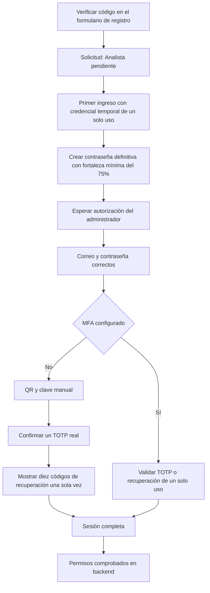

# Autenticación y administración de TacticLens

El acceso web requiere tres condiciones independientes: correo verificado, autorización administrativa y MFA confirmado. Los dos roles, **Administrador de seguridad** y **Analista de seguridad**, usan obligatoriamente Google Authenticator u otra aplicación TOTP estándar. No se utiliza OAuth ni una API de Google.

**Registro público actualizado:** la verificación se realiza ahora en el mismo formulario, antes de crear la cuenta. Se envía una credencial temporal y se exige definir la contraseña en el primer ingreso. Administración permite aceptar o rechazar solicitudes. Consulte [el flujo vigente y sus pruebas](REGISTRO_GUIADO.md). Los pasos anteriores de contraseña/correo de esta guía siguen aplicando al bootstrap por CLI y a las cuentas existentes.

## Arquitectura y alcance

Se conserva React 19/TypeScript/Vite, FastAPI, SQLAlchemy Core con reflexión y PostgreSQL. Se reutilizan `honeypot.usuario` y `honeypot.rol`; no hay un segundo almacén de identidad ni una plataforma multiempresa. Las consultas SQL emplean parámetros y las migraciones SQL se registran por versión y checksum.

El servidor mantiene sesiones opacas en PostgreSQL. La cookie contiene un valor aleatorio de 256 bits; la base solo conserva su HMAC. El navegador no guarda contraseñas, sesiones, TOTP ni tokens de recuperación en localStorage o sessionStorage. El token CSRF permanece en memoria; su cookie es HttpOnly. Un desafío de contraseña correcta **no** es una sesión plenamente autenticada.



La ingesta automática permanece separada: `/api/ingesta/eventos` y `/api/ingesta/heartbeat` siguen exigiendo `X-API-Key`, sin cookies ni MFA de usuario. El resto de módulos privados requiere sesión completa desde middleware y las rutas administrativas comprueban además el rol. `/api/health` solo expone salud operativa y no requiere sesión.

| Operación | Analista | Administrador |
|---|---|---|
| Consultar métricas, sesiones, eventos, análisis, IoCs y MITRE | Sí | Sí |
| Ejecutar análisis de sesiones | Sí | Sí |
| Importar archivos Cowrie manualmente | No | Sí |
| Gestionar su contraseña, autenticador y códigos | Sí, con reautenticación | Sí, con reautenticación |
| Consultar usuarios, roles y auditoría | No | Sí |
| Aceptar una solicitud pendiente | No | Sí, con código nuevo de Google Authenticator |
| Rechazar, suspender, cambiar rol de cuenta aprobada o reaprobar una rechazada | No | Sí, con contraseña y segundo factor |
| Restablecer MFA de otra cuenta | No | Sí, con verificación de identidad y reautenticación |
| Cambiar unilateralmente su propio rol/estado o restablecer administrativamente su propio MFA | No | No |

## Preparación local exacta

Ejecute desde la raíz del repositorio en PowerShell. PostgreSQL debe contener el esquema original del proyecto y la extensión `vector`. Si ya hay datos, **no** vuelva a ejecutar `database/honeypot_schema.sql`: aplique solamente las migraciones nuevas.

```powershell
# Solo si todavía no existe el entorno virtual:
python -m venv .venv
.\.venv\Scripts\python.exe -m pip install -r requirements.txt

# Solo si todavía no existe .env:
if (-not (Test-Path .env)) { Copy-Item .env.example .env }

# Complete DATABASE_*, HONEYPOT_ID e INGEST_API_KEY antes de continuar.
# Este comando añade solo claves y opciones ausentes; no imprime secretos.
.\.venv\Scripts\python.exe -m scripts.configure_auth

# Migración transaccional y reproducible; no borra registros existentes.
.\.venv\Scripts\python.exe -m scripts.migrate

# Primer administrador: solicita los datos y la contraseña en la terminal.
.\.venv\Scripts\python.exe -m scripts.create_admin

# Backend del laboratorio, accesible también desde la VM:
.\.venv\Scripts\python.exe -m uvicorn backend.api:app --host 192.168.56.1 --port 8000
```

En otra terminal, desde la raíz:

```powershell
cd frontend
npm.cmd ci
if (-not (Test-Path .env.local)) { Copy-Item .env.example .env.local }
# VITE_API_PROXY_TARGET=http://192.168.56.1:8000 para el laboratorio original.
npm.cmd run dev
```

Abra `http://127.0.0.1:5173/login`. Para backend exclusivamente local, use `--host 127.0.0.1` y cambie `VITE_API_PROXY_TARGET` a `http://127.0.0.1:8000`. Vite y FastAPI tienen que coincidir. El valor `DEV_HOST_IP` anterior ya no concede acceso a módulos privados: una IP no sustituye la autenticación.

Después de aplicar este cambio debe reiniciar cualquier proceso antiguo de FastAPI. El arranque valida las claves y refleja las tablas de seguridad; si falta una migración o una clave, no se habilita un modo inseguro alternativo.

## Primer administrador

`scripts.create_admin` es una herramienta local que requiere acceso a PostgreSQL y al entorno del servidor. No existe un endpoint web de bootstrap ni credenciales predeterminadas. Usa exactamente la validación del registro normal, pide la contraseña con `getpass` y se niega a crear otro administrador cuando ya existe uno. Una exclusión mutua transaccional evita dos bootstrap simultáneos.

El administrador inicial queda autorizado, pero **todavía debe verificar el correo y confirmar Google Authenticator**. Más administradores se crean registrando cuentas normales y asignando el rol desde una sesión administrativa con reautenticación. Mantenga al menos dos administradores y copias de los códigos de recuperación, en custodias independientes.

Si ya registró su cuenta desde la interfaz y quedó pendiente **sin que exista ningún administrador**, no necesita otra identidad ni otro registro. Después de verificar el correo, ejecute desde la raíz:

```powershell
.\.venv\Scripts\python.exe -m scripts.create_admin --existente
```

Introduzca el correo y la contraseña actual en la terminal. El comando local verifica ambos requisitos, conserva el registro y cualquier MFA existente, autoriza la cuenta como primer Administrador y revoca sus sesiones previas. Recargue la interfaz e inicie sesión para vincular o verificar Google Authenticator. El comando se niega a operar cuando ya hay un administrador; no es un endpoint web ni sustituye la administración normal.

No comparta contraseñas ni cédulas por chats de desarrollo para ejecutar este comando. El titular introduce sus datos en la terminal local.

## Buzón de correo de desarrollo y SMTP

El modo elegido para este entorno es `MAIL_TRANSPORT=file`. Cada mensaje multipart en español se escribe en `.local/mail/*.eml`. Abra el archivo más reciente con un lector de correo o un editor de texto. El código aparece en el cuerpo de texto del mensaje. No se publica por un endpoint, no se imprime en logs y no se envía a un proveedor externo.

```powershell
Get-ChildItem .local/mail -Filter *.eml | Sort-Object LastWriteTime -Descending | Select-Object -First 5 Name,LastWriteTime
```

Esta carpeta y los `.eml` están excluidos de Git. Los archivos son correo privado, contienen códigos/enlaces temporales y deben quedar accesibles únicamente al desarrollador. En Windows revise la ACL NTFS de `.local` y `.env`; los modos POSIX no sustituyen esos permisos. Retire manualmente los mensajes que ya no necesite conforme a su política local.

Para correo real use `MAIL_TRANSPORT=smtp`, `MAIL_FROM`, `SMTP_HOST`, `SMTP_PORT`, `SMTP_USER` y `SMTP_PASSWORD`. Puerto 587 suele usar `SMTP_STARTTLS=true, SMTP_SSL=false`; para TLS implícito configure el puerto que indique su proveedor y `SMTP_SSL=true`. Se valida el certificado TLS. No hay contraseñas ni remitentes reales incorporados al repositorio. Producción exige TLS en SMTP y rechaza el transporte de archivos.

Si el transporte falla, se registra `correo_entrega_fallida` sin incluir el mensaje ni el error del proveedor. El usuario puede solicitar un nuevo envío después del intervalo. No se ha implementado una cola de reintentos de SMTP; antes de producción debe supervisarse la entrega y elegirse una política de reintentos según el servidor de correo.

## Configuración

| Variable | Significado / valor inicial |
|---|---|
| `AUTH_SECRET_KEY` | Secreto aleatorio de al menos 64 caracteres para HMAC y firma CSRF; generado por CLI |
| `AUTH_TOTP_KEYS` | Claves Fernet externas a PostgreSQL; la primera cifra y todas permiten descifrar |
| `AUTH_ENV` | `development` o `production`; si se omite, se exige producción |
| `AUTH_COOKIE_SECURE` | `false` solo para HTTP local; `true` obligatorio en producción |
| `AUTH_PUBLIC_URL` | Origen público confiable para los enlaces de recuperación, sin depender del Host recibido |
| `AUTH_ALLOWED_ORIGINS` | Lista exacta de orígenes del frontend; sin comodines |
| `AUTH_EMAIL_TTL_SECONDS` | 300: caducidad del código de correo |
| `AUTH_RESEND_SECONDS` | 60: intervalo mínimo entre correos |
| `AUTH_MAX_ATTEMPTS` | 5: máximo de intentos de códigos y reautenticación por cuenta |
| `AUTH_CHALLENGE_SECONDS` | 300: duración del acceso primario restringido |
| `AUTH_SESSION_SECONDS` | 28800: duración absoluta de una sesión completa |
| `AUTH_IDLE_SECONDS` | 1800: inactividad máxima; el polling del panel no la prolonga |
| `AUTH_RESET_SECONDS` | 900: caducidad del enlace de contraseña |
| `DATABASE_PORT` | 5432 por defecto; compartido por API y migraciones |

Las claves se crean una sola vez. No las regenere al reiniciar. Al rotar Fernet conserve la clave antigua en la lista hasta recifrar y verificar los factores existentes y sus respaldos; no hay una herramienta automática de recifrado en esta entrega. Perder todas las claves Fernet impide validar los factores almacenados. Cambiar `AUTH_SECRET_KEY` invalida sesiones, códigos y tokens existentes, por lo que requiere una ventana de mantenimiento y un procedimiento de recuperación autorizado.

## Modelo de datos y migraciones

`database/honeypot_schema.sql` sigue siendo el esquema base. Después se ejecutan las migraciones `001_auth.sql`, `002_auditoria_inmutable.sql`, `003_registro_guiado.sql` y `004_historial_credencial_temporal.sql` mediante `scripts.migrate`. El runner registra checksum y versión en `honeypot.schema_migration`, aplica cada archivo una sola vez y detecta si se alteró uno ya aplicado. Antes de normalizar correos detecta colisiones y se detiene sin eliminar cuentas. Cualquier error revierte la migración completa. La segunda migración impide UPDATE/DELETE de auditoría mediante un trigger y asegura la fecha de modificación de roles. Las últimas incorporan verificación previa al registro, credenciales temporales, rechazo administrativo e historial protegido para impedir reutilizar la credencial enviada por correo.

| Entidad | Cambios |
|---|---|
| `usuario` existente | Cédula, nombres, apellidos, nombre de usuario, fecha de correo verificado, autorización administrativa y su actor/fecha, creado_por y modificado_por |
| `rol` existente | Código estable de Administrador/Analista reutilizando los registros, estado_registro y actores de auditoría |
| `auth_factor` | Secreto cifrado, confirmación, caducidad de la vinculación pendiente y último intervalo TOTP aceptado |
| `auth_token` | HMAC de código/enlace, propósito, caducidad, intentos y fecha de uso |
| `auth_sesion` | HMAC del token, etapa explícita, validación primaria/MFA, expiración, actividad, revocación y hash de IP |
| `auth_recuperacion` | HMAC de cada código y uso único |
| `auth_limite` | Contadores persistentes por IP/cuenta, compartidos por workers |
| `auth_auditoria` | Actor, usuario afectado, tipo, fecha y metadatos permitidos; API de solo lectura |

Todas las tablas de seguridad incluyen estado_registro, creado_por, modificado_por, creado_en y actualizado_en. Se conserva `activo` como estado general del usuario/rol en lugar de duplicarlo. `autorizacion`, `correo_verificado_en` y `auth_factor.confirmado_en` representan conceptos distintos. La actualización temporal reutiliza el trigger de auditoría existente. No se introduce una clase ORM ficticia: el proyecto usa Core y la convención común se aplica desde la migración.

Las restricciones únicas protegen cédula, nombre de usuario normalizado y correo normalizado. La autorización y las etapas tienen CHECK; una sesión `completa` exige fecha de MFA. Hay claves foráneas e índices para consultas por usuario, propósito y fecha. Los usuarios anteriores conservan sus registros; quedan pendientes de verificación y autorización, y no pueden entrar con un hash legado que no pueda verificarse. Se utiliza recuperación de contraseña para establecer un hash Argon2id.

## Validación y controles

- Cédula: diez dígitos ASCII, provincia 01–24 o 30, tercer dígito menor de seis y módulo 10 para persona natural. Esto valida matemáticamente el número; no consulta ni certifica identidad ante el Registro Civil. El código 30 se contempla para identificaciones emitidas en el exterior.
- Nombres: normalización Unicode NFC, letras y marcas combinadas, espacios, apóstrofos, puntos y guiones; no se restringe a ASCII.
- Usuario: NFKC, espacios exteriores eliminados y minúsculas; de 3 a 64 caracteres ASCII permitidos.
- Correo: `email-validator`, espacios exteriores eliminados, normalización y minúsculas; dominio internacional normalizado. No se consulta DNS ni se considera esa validación como prueba de titularidad.
- Contraseña: entre 12 y 128 caracteres, sin truncar el hash; zxcvbn rechaza contraseñas comunes o adivinables y considera datos personales. Se admiten gestores, pegado, Unicode y frases largas. Confirmación solo en memoria, nunca en SQL.
- Hash: Argon2id con 64 MiB, tres iteraciones y paralelismo cuatro; sales generadas por la biblioteca. Los hashes que lo necesiten se actualizan tras verificar correctamente la contraseña.
- Correo: seis dígitos aleatorios, HMAC con clave externa y contexto del token, cinco minutos, cinco intentos, uso único, reenvío espaciado e invalidación del código anterior. Las respuestas de reenvío y recuperación son genéricas.
- MFA: PyOTP/RFC 6238, seis dígitos, SHA-1, treinta segundos y tolerancia ±1 intervalo. El secreto se cifra con Fernet autenticado. El último intervalo aceptado se actualiza bajo bloqueo por usuario, impidiendo reutilización entre sesiones/workers.
- Recuperación: diez códigos de 128 bits, una sola visualización y HMAC; consumo atómico. Regeneración y reemplazo del teléfono requieren contraseña más segundo factor vigente o recuperación no utilizada.
- Sesiones: tokens aleatorios, rotación al pasar de desafío a acceso completo, HttpOnly, SameSite=Strict, Secure en producción, expiración absoluta e inactividad. El frontend notifica actividad real como máximo cada minuto; la actualización automática de métricas no mantiene una sesión abandonada.
- CSRF: cookie y cabecera coincidentes, token firmado y origen exacto para todas las escrituras del navegador, incluido login. Las peticiones de autenticación se limitan a 16 KiB incluso sin Content-Length.
- Rate limiting: ventanas persistentes de quince minutos por cuenta e IP; login inicialmente 10 intentos por cuenta y 40 por IP, y códigos según `AUTH_MAX_ATTEMPTS`. Hay límites adicionales para registro, correos y reautenticación. El contador de cuenta se reinicia tras una validación exitosa de login/MFA; los contadores por IP siguen limitando el volumen total.
- Auditoría: registro, autorizaciones, intentos, MFA, recuperación, cambios, suspensión y cierre de sesión. Solo se aceptan metadatos seguros; no se registran contraseñas, códigos, tokens, secretos TOTP ni cédulas. Las respuestas de validación omiten los valores rechazados de Pydantic.

## Recuperación del segundo factor

1. Con teléfono perdido, entrar con contraseña y un código de recuperación disponible.
2. En **Seguridad de mi cuenta → Reemplazar Google Authenticator**, reautenticarse usando otro código de recuperación no utilizado (o el TOTP si todavía lo tiene).
3. Se revocan sesiones y códigos anteriores. El usuario solo obtiene acceso restringido a vinculación.
4. Escanear el QR nuevo, confirmar un TOTP real y guardar los nuevos códigos. Hasta entonces la API niega los módulos.
5. Si no hay teléfono ni códigos, otro administrador debe verificar la identidad por un canal independiente: entrevista presencial o canal corporativo previamente acreditado, contraste con el expediente de la organización y autorización documentada. Una solicitud por correo no basta.
6. Registrar una referencia de expediente sin documentos, cédulas ni información sensible en el formulario administrativo; el sistema guarda únicamente su HMAC en auditoría.
7. El administrador se reautentica con contraseña y segundo factor, restablece la cuenta ajena y el titular recibe una notificación. Se revocan sesiones y códigos del titular. El siguiente acceso vuelve a exigir una vinculación confirmada.

El sistema no puede certificar automáticamente una verificación presencial. El administrador es responsable de aplicar el procedimiento y conservar el expediente por separado. No hay excepción web para que el único administrador sin teléfono ni códigos se restablezca a sí mismo. En ese caso se necesita un procedimiento institucional de recuperación operado por custodios autorizados de la base; no se incorpora un bypass automático. Por eso se requieren custodias independientes, códigos fuera del teléfono y al menos dos administradores.

Restablecer la contraseña por correo nunca desactiva MFA. Tanto el cambio autenticado como la recuperación invalidan los enlaces de contraseña pendientes y revocan las sesiones anteriores.

## Endpoints

Todos tienen el prefijo `/api/auth`. Salvo los GET, requieren origen autorizado, cookie CSRF y cabecera `X-CSRF-Token`.

| Método y ruta | Finalidad / acceso |
|---|---|
| GET `/csrf` | Obtener protección CSRF sin sesión |
| POST `/registro` | Solicitar cuenta, sin poder elegir rol |
| POST `/correo/reenviar` | Solicitar código; respuesta genérica |
| POST `/correo/verificar` | Consumir código de correo |
| POST `/login` | Contraseña y desafío restringido |
| GET `/me` | Etapa y perfil permitido de la sesión |
| POST `/mfa/configuracion` | QR y clave solo durante vinculación autorizada |
| POST `/mfa/confirmar` | Confirmar vinculación, códigos una sola vez y sesión completa |
| POST `/mfa/verificar` | TOTP o recuperación como segundo factor |
| POST `/mfa/codigos` | Regenerar recuperación con reautenticación |
| POST `/mfa/reemplazar` | Reautenticar y volver a vinculación restringida |
| POST `/password/solicitar` | Solicitar enlace temporal |
| POST `/password/restablecer` | Consumir enlace y cambiar contraseña, sin omitir MFA |
| POST `/password/cambiar` | Cambiar contraseña con reautenticación |
| POST `/logout` | Revocar la sesión actual |
| POST `/sesiones/revocar` | Cerrar todas con reautenticación |
| GET `/admin/roles` | Catálogo de roles, solo administrador |
| GET `/admin/usuarios` | Cuentas paginadas, solo administrador |
| PATCH `/admin/usuarios/{id}` | Autorizar, rol o estado; reautenticación y revocación |
| POST `/admin/usuarios/{id}/mfa/restablecer` | Restablecimiento ajeno documentado, con reautenticación |
| GET `/admin/auditoria` | Eventos paginados de solo lectura |

No se envían secretos por query strings. Los enlaces de recuperación llevan el token en el fragmento del navegador, que no se envía al servidor ni a sus access logs; la pantalla lo retira de la barra y lo conserva solo en memoria para el POST.

## Pruebas automatizadas

Con PostgreSQL local, `.env` configurado y migración aplicada:

```powershell
.\.venv\Scripts\python.exe -B -m unittest discover -s tests -v
cd frontend
npm.cmd run build
```

`test_auth.py` prueba el backend real con TestClient, cookies reales, CSRF, Argon2id, restricciones SQL, estados de cuenta y TOTP. Solo sustituye el transporte de correo y controla el reloj de TOTP; cada caso usa una transacción externa que se revierte. No se consumen créditos de DeepSeek ni se envía correo externo. `test_core.py` conserva sus pruebas y `test_live.py` verifica los módulos previos aislando la autenticación y el proveedor LLM. Los catálogos necesarios de esas pruebas también se revierten.

La compilación comprueba TypeScript. Se revisaron visualmente acceso, registro, verificación y recuperación, incluyendo el formulario de registro en ancho móvil. La validación del QR y TOTP se prueba por API con valores RFC; escanear con un teléfono real se incluye en el procedimiento manual siguiente.

## Prueba manual completa

1. Preparar configuración, migración y primer administrador mediante los comandos anteriores. Elegir sus propios datos; no hay usuario/contraseña de ejemplo habilitados.
2. Abrir el `.eml` de verificación del administrador en `.local/mail`, entrar en **Verificar mi correo** e introducir correo y código.
3. Iniciar sesión con correo y contraseña. Al estar autorizado por el bootstrap, se ofrece **Vincule su autenticador**.
4. Pulsar **Preparar código QR**. En Google Authenticator, añadir una cuenta mediante **Escanear un código QR**. Como alternativa usar la clave manual, tipo basado en tiempo.
5. Introducir los seis dígitos actuales y confirmar. La hora automática debe estar activada en el teléfono y la hora del servidor sincronizada.
6. Guardar los diez códigos, pulsar **Ya los guardé** y entrar al panel. Cerrar sesión y volver a entrar: debe pedirse nuevamente Google Authenticator. Un código que acaba de aceptarse no puede reutilizarse; esperar el siguiente intervalo.
7. En otro navegador/perfil, abrir el registro y completar datos propios y cédula matemáticamente válida. Pulsar **Verificar correo**, introducir el código del nuevo `.eml` en el mismo formulario y enviar la solicitud. No se puede elegir rol ni contraseña durante el registro.
8. Abrir el mensaje con la credencial temporal, iniciar sesión y crear una contraseña definitiva con al menos 75% de fortaleza. Comprobar que el analista solo ve autorización pendiente. Abrir `/api/sesiones` sin sesión o sin MFA debe devolver 401/403, respectivamente.
9. En la cuenta administrativa, abrir **Administrar usuarios**, seleccionar la solicitud pendiente y **Aceptar solicitud**; introducir únicamente un código nuevo de su propio Google Authenticator. Guardar. Con otra solicitud puede probar **Rechazar solicitud**, indicando el motivo, contraseña administrativa y segundo factor.
10. El analista vuelve a iniciar sesión, escanea su propio QR, confirma TOTP, guarda códigos y accede. No puede administrar usuarios ni importar archivos manualmente.
11. Probar recuperación de contraseña con el enlace del buzón local. Las sesiones se revocan y el inicio posterior sigue exigiendo el mismo segundo factor.
12. Probar un código de recuperación al iniciar sesión; su segundo uso debe fallar. Probar reemplazo del teléfono desde Seguridad usando contraseña y otro código no utilizado.
13. Suspender una cuenta con sesión abierta desde otra cuenta administrativa. La siguiente solicitud del titular debe ser rechazada. Revisar el evento en auditoría.

## Producción y límites operativos

El despliegue público no forma parte de esta entrega. Antes de hacerlo: TLS en el origen del frontend y proxy, `AUTH_ENV=production`, cookies Secure, orígenes exactos, SMTP TLS probado, sincronización horaria, respaldo/custodia externa de claves, acceso mínimo de PostgreSQL, ACL de archivos y política de retención de auditoría. Configure límites de concurrencia y supervisión adecuados al coste de Argon2id.

No confíe en `X-Forwarded-For` arbitrario: los límites usan la IP del cliente ASGI. Configure el proxy de confianza explícitamente si incorpora uno. En desarrollo Vite concentra conexiones de API; el límite por IP se comparte entre usuarios del laboratorio y puede devolver 429 al hacer muchas pruebas en quince minutos. No existe un interruptor web para desactivar ese límite ni MFA.

Se recomienda un rol de migración separado del rol de aplicación y permisos PostgreSQL sin actualización/eliminación de auditoría. La API no proporciona esas operaciones. No se configuraron roles del servidor PostgreSQL, infraestructura externa, SMTP real ni políticas de retención de la organización automáticamente.

## Referencias técnicas

- [RFC 6238: TOTP y rechazo de reutilización](https://www.rfc-editor.org/rfc/rfc6238.html).
- [OWASP: autenticación](https://cheatsheetseries.owasp.org/cheatsheets/Authentication_Cheat_Sheet.html).
- [OWASP: almacenamiento de contraseñas](https://cheatsheetseries.owasp.org/cheatsheets/Password_Storage_Cheat_Sheet.html).
- [OWASP: autenticación multifactor y recuperación](https://cheatsheetseries.owasp.org/cheatsheets/Multifactor_Authentication_Cheat_Sheet.html).
- [OWASP: recuperación de contraseñas](https://cheatsheetseries.owasp.org/cheatsheets/Forgot_Password_Cheat_Sheet.html).
- [OWASP: sesiones](https://cheatsheetseries.owasp.org/cheatsheets/Session_Management_Cheat_Sheet.html).
- [OWASP: CSRF](https://cheatsheetseries.owasp.org/cheatsheets/Cross-Site_Request_Forgery_Prevention_Cheat_Sheet.html).
- [PyOTP: TOTP y URI compatibles con Google Authenticator](https://pyauth.github.io/pyotp/).
- [argon2-cffi](https://argon2-cffi.readthedocs.io/en/stable/howto.html) y [Fernet/MultiFernet](https://cryptography.io/en/latest/fernet/).
